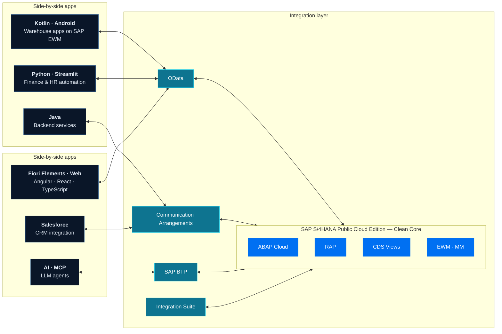

# How I build (Mermaid version)

Native alternative to `architecture-dark.svg` / `architecture-light.svg`.
GitHub renders Mermaid natively and adapts it to the viewer's theme. To use it
on the profile, paste the block below into `README.md` in place of the
`<picture>` under **How I build**.

